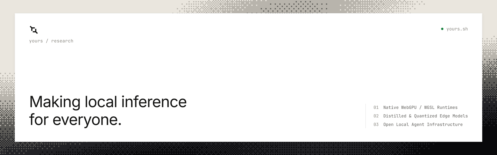

  <a href="https://yours.sh">
    <picture>
      <source media="(prefers-color-scheme: dark)" srcset="https://raw.githubusercontent.com/yours-research/.github/main/profile/assets/hero-dark.png" />
      <source media="(prefers-color-scheme: light)" srcset="https://raw.githubusercontent.com/yours-research/.github/main/profile/assets/hero-light.png" />
      
    </picture>
  </a>

  

    <a href="https://yours.sh"><strong>yours.sh</strong></a>
    &nbsp;&middot;&nbsp;
    <a href="https://huggingface.co/yours-research"><strong>Hugging Face</strong></a>
    &nbsp;&middot;&nbsp;
    <a href="https://x.com/yoursdotsh"><strong>X (@yoursdotsh)</strong></a>
  

**Yours Research** is an independent lab building hardware-co-designed small language models, browser-native WebGPU inference runtimes, and open local agent infrastructure so capable intelligence runs privately on the device in front of you.

## Research & Engineering

| Focus | Scope |
| :--- | :--- |
| **Browser-Native Compute** | Custom Rust WASM + native WGSL WebGPU kernels featuring `q4f16` quantization, INT8/FP16 FlashDecoding, chunkwise Gated DeltaNet prefill, zero-weight speculative decoding, and 100% offline execution. |
| **Edge Model Optimization** | Quantization-aware distillation, merge-closure-safe vocabulary pruning, and hardware-co-designed small models (**Pragma**) tailored for consumer GPUs and laptop integrated graphics. |
| **Local Agent Infrastructure** | Durable chat harnesses with recoverable SQLite runs, ordered tool-call streams, and lightweight embedded browser runtimes built for local-first automation. |

## Open Source

| Repository | Description | Stack |
| :--- | :--- | :--- |
| [`yours-browser-extension`](https://github.com/yours-research/yours-browser-extension) | Offline-first Chromium MV3 AI side panel powered by a custom Rust WASM + native WGSL WebGPU compute engine. | `TypeScript` &middot; `Rust` &middot; `WGSL` |
| [`tiny-chat`](https://github.com/yours-research/tiny-chat) | Durable, open-source chat harness for local AI models with recoverable runs, ordered events, and SQLite persistence. | `TypeScript` &middot; `AI SDK` &middot; `llama.cpp` |
| [`tiny-browser`](https://github.com/yours-research/tiny-browser) | Web-embedded browser and compact semantic tree runtime for browser agents. | `TypeScript` &middot; `MIT` |

 

  <code>yours / research</code> &nbsp;&middot;&nbsp; Making local inference for everyone.

